# Data East MLC core for MiSTer

A MiSTer FPGA core for Data East's MLC arcade hardware (MAME's `deco_mlc.cpp`), built with Quartus
Prime 17.0.2 Lite for the DE10-nano. Two bitstreams: `DecoMLC` for the SH-2
board (Avengers in Galactic Storm) and `DecoMLC156` for the boards with the DE156, Data East's
encrypted ARM.

## Contents

- [History](#history)
- [Games](#games)
  - [Supported](#supported)
- [Hardware](#hardware)
  - [Video timing](#video-timing)
  - [Floorplan](#floorplan)
- [Screenshots](#screenshots)
- [Installation](#installation)
- [Controls](#controls)
- [Status](#status)
  - [Features](#features)
  - [Todo](#todo)
  - [Resource usage](#resource-usage)
- [AI Attestation](#ai-attestation)
- [Verification](#verification)
- [Acknowledgements](#acknowledgements)
- [Layout](#layout)
- [License](#license)

## History

**Arcade-DecoMLC_20261027, Arcade-DecoMLC156_20261027**
- Scandoubler Fx fixed: any setting froze the HDMI picture, on both cores. CRT Adjust's HBlank stayed
  high through the vertical blank, so the scandoubler never produced VSync.

**Arcade-DecoMLC_20261026, Arcade-DecoMLC156_20261026**
- First release: All 5 games are playable. 
- Including Skull Fang and Accii, and the test modes (which all hang in MAME due to raster IRQ handling)
- Changed the sprite zoom algo to use a single accumulator and use the stride directly rather than a lookup table->scale
- Known bug: Scandoubler FX seem to be busted (fixed in 20261027).

## Games

### Supported

Sets with an `.mra` in `releases/`, clones in `_alternatives`. All working.

| Name | Year | Manufacturer | Core | Status |
|-|-|-|-|-|
| Avengers In Galactic Storm (US/Europe 1.0, Japan 1.2) | 1995 | Data East Corporation | DecoMLC | working |
| Stadium Hero '96 (Europe EAJ, USA EAH, Japan EAD, Japan EAE, Korea) | 1996 | Data East Corporation | DecoMLC156 | working |
| Skull Fang (Europe 1.13, Japan 1.09, Asia 1.13) | 1996 | Data East Corporation | DecoMLC156 | working |
| Hoops '96 (Europe/Asia 2.0), Hoops (Europe/Asia 1.7), Dunk Dream '95 (Japan 1.4) | 1995-96 | Data East Corporation | DecoMLC156 | working |
| Janken Game Acchi Muite Hoi! (Japan 1.3) | 1995 | Data East Corporation | DecoMLC156 | working |

## Hardware

| Chip | Function | Status |
|-|-|-|
| Hitachi SH7604 (SH-2), 21 MHz | main CPU, Avengers | srg320's core as redistributed in jotego's jtcores, with its `jtsh7604` wrapper, unchanged but for two restored cache lines; boot and system traces against MAME |
| DE156 (encrypted ARM), MAME's 7 MHz times its clock scale | main CPU, the other sets | the Amber a23 ARMv2a from Deco156Simple, with MAME's coprocessor 0 (BCD arithmetic, divide) added; the program descrambled at fetch (Deco156Simple's `jtosman_deco156`); bus trace against MAME |
| DE150 / DE223 | sprites: zoom, 8bpp pairs, clip windows, raster sets, shadow | written here from `deco_mlc_v.cpp` against a Python transcription; 4bpp, 5bpp, 6bpp and acchi layouts; X zoom from one accumulator a sprite, not MAME's per-tile restart |
| DECO 146 | protection, Stadium Hero '96 | written here, the whole of MAME's `deco146.cpp` as the MLC wires it |
| Yamaha YMZ280B | 8-channel ADPCM sound | srg320's, from the SKNS core, with four marked fixes found against a port of MAME's chip |
| 93C45 EEPROM | settings | jotego's `jt9346` |

### Video timing

7 MHz pixel clock, 442 dots a line, 274 lines a frame: 15.84 kHz and 57.80 Hz, 320 x 240 visible
(MAME's lines 8-247). The driver gives no raw timing (`set_refresh_hz(58)`); these are Data East's
numbers for its other 320 x 240 boards (`cninja.cpp`), a choice recorded in `docs/HACKS.md`.

### Floorplan

Where the logic sits on the Cyclone V, read from the compiled design with `scripts/floorplan.py`
(default grouping; block names in [`docs/floorplan/`](docs/floorplan/)). The release builds of
`2b25f70`, fitted Oct 27 2026.

`DecoMLC`:

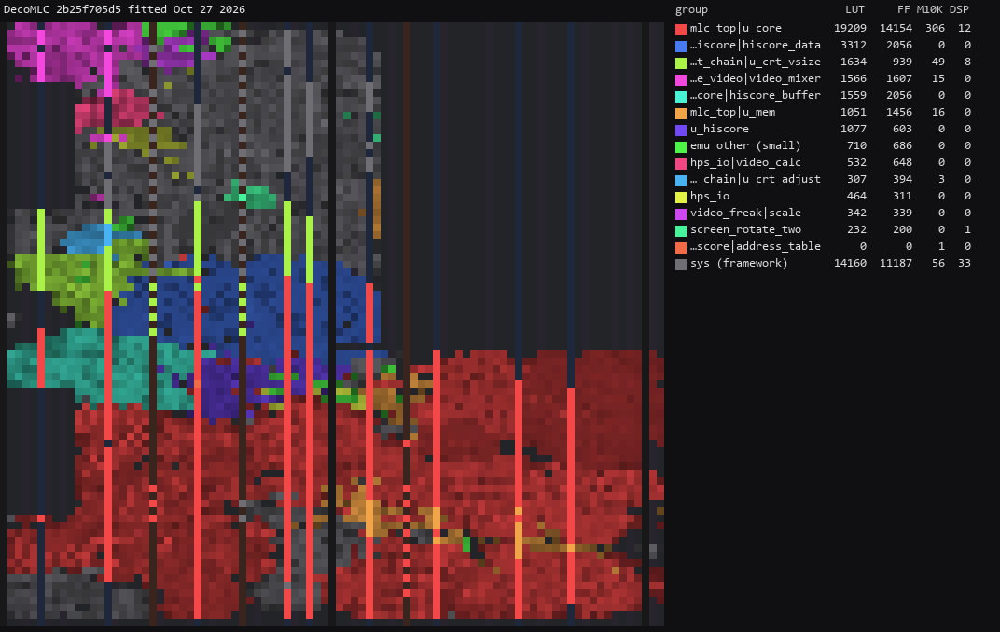

`DecoMLC156`:

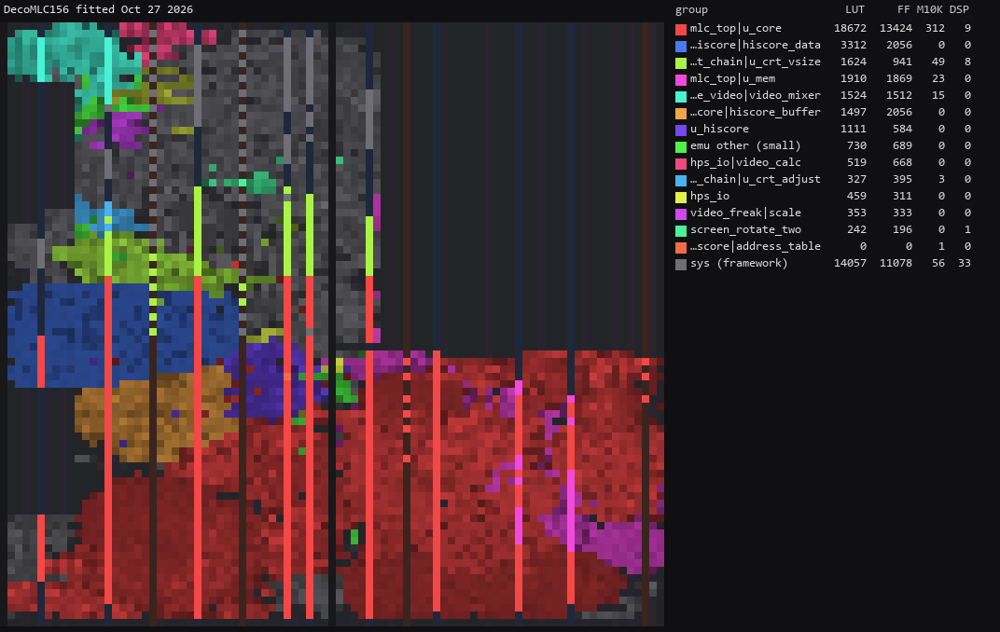

## Screenshots

Screenshots from the board.

### Avengers in Galactic Storm

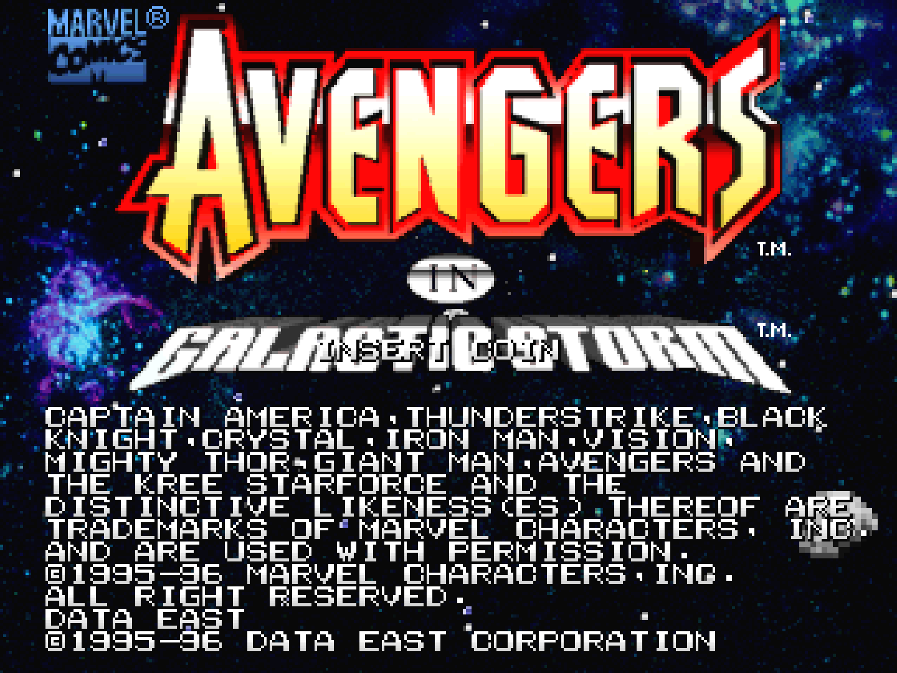
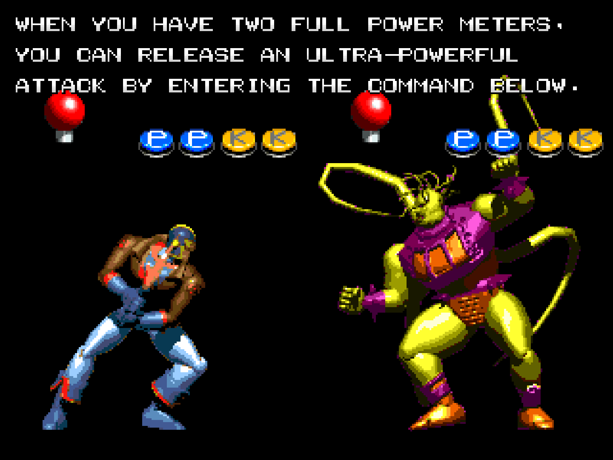
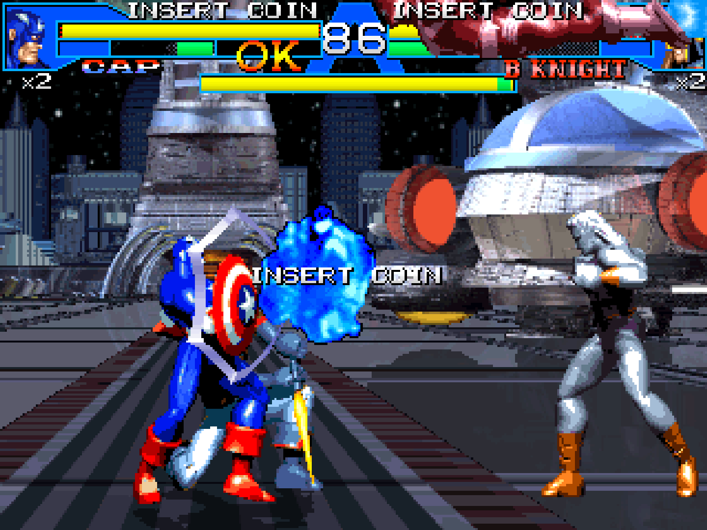
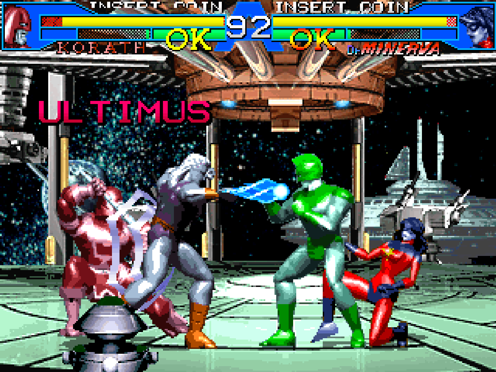

### Stadium Hero '96

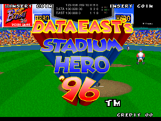

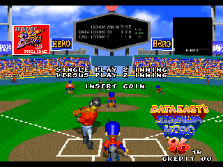

### Skull Fang

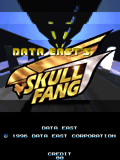

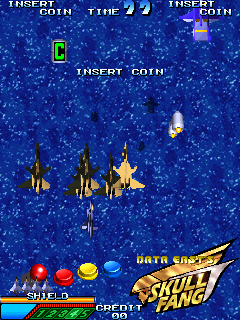

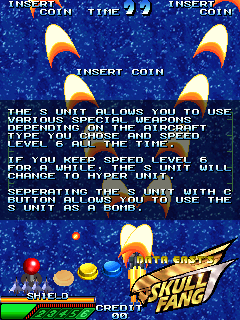

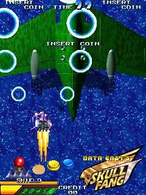

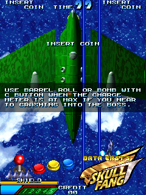

### Hoops '96

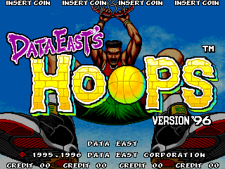
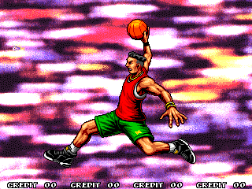
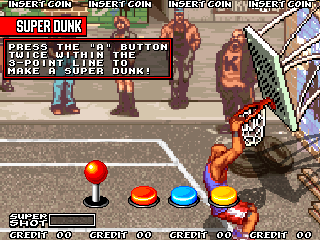
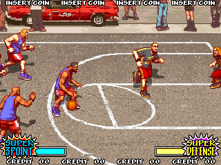

### Janken Game Acchi Muite Hoi!

## Installation

A 32 MB SDRAM module is required.

* Take the latest `*.rbf` from `releases/` and put it in `_Arcade/cores`, renamed to drop the
  `Arcade-` prefix (`Arcade-DecoMLC_YYYYMMDD.rbf` becomes `DecoMLC_YYYYMMDD.rbf`). MiSTer launches
  the highest-sorting match for `<rbf>DecoMLC</rbf>`, and a `DecoMLC_*.rbf` sorts above every
  `Arcade-DecoMLC_*.rbf`
* Take the `*.mra` files and the `_alternatives` folder from `releases/` and put them in `_Arcade`
  (or a subdirectory starting with an underscore, e.g. `_Arcade/_DecoMLC`)
* Put the MAME merged or split ROM sets in `games/mame`

To run a development build instead: `python scripts/build_staged.py` (or `--rev DecoMLC156_stp`
for the DE156 sets), then `python scripts/deploy.py` with a `mister.env` (see `scripts/deploy.py`).

## Controls

An 8-way joystick and up to four buttons a player, then Start, Coin, Pause and Test (the test
switch, for service mode; no default pad button, assign it in Define buttons):

| Game | Buttons |
|-|-|
| Avengers in Galactic Storm | Light Punch, Heavy Punch, Light Kick, Heavy Kick |
| Stadium Hero '96 | Dash, Pitch/Swing, Bunt/Substitute |
| Skull Fang | Shot, Shot/Throttle, Barrel Roll/Bomb |
| Hoops '96 | Shoot, Pass, Switch Player |
| Acchi Muite Hoi! | Upper Button, Lower Button, the grip lever's: both held Rock, Lower alone Scissors, neither Paper; Start advances |

Keyboard, MAME's defaults: arrows / R F D G, buttons LCtrl LAlt Space LShift / A S Q W, Start 1 /
2, Coin 5 / 6; F2 test switch, 9 / 0 service coins, P pause.

## Status

Known issues:

- **Sprite X zoom differs from MAME by design**: one source accumulator a
  sprite instead of MAME's per-tile restart.
- The video timing is a choice, not a measurement (Video timing).
- The palette is looked up a line after MAME draws the line; Stadium Hero '96 changes it mid-frame
  about twice a frame.

`docs/MAME_KLUDGES.md` lists what is taken from MAME as behaviour and what is known not to be
right. `docs/HACKS.md` lists this core's own approximations. `docs/ROADMAP.md` is the plan and its
progress; `docs/LESSONS_LEARNED.md` is what it cost.

### Todo

- [ ] Savestates

### Resource usage

The release builds of `2b25f70` on the DE10-nano's Cyclone V 5CSEBA6, speed grade 7, timing met
(worst setup slack over all clocks and corners: `DecoMLC` 0.355 ns, `DecoMLC156` 0.096 ns):

| resource | `DecoMLC` | `DecoMLC156` | available |
| --- | --- | --- | --- |
| Logic (ALMs) | 26,414 | 26,908 | 41,910 |
| Block memory bits | 3,199,677 | 3,293,373 | 5,662,720 |
| RAM blocks | 446 | 459 | 553 |
| DSP blocks | 54 | 51 | 112 |
| PLLs | 3 | 3 | 6 |

RAM blocks are the resource to watch: main RAM and VRAM are on-chip.

## AI Attestation

This core is being developed with heavy use of a frontier coding assistant (Anthropic's Claude),
directed by the repository's owner, who reviews the work and runs the hardware checks.

## Verification

Not PCB-validated. MAME is the accuracy reference, with its own acknowledged uncertainties noted
where they matter (`docs/MAME_KLUDGES.md`). The DE156 references are MAME's `deco_mlc.cpp` at
`df450c1`, which re-arms the scanline interrupt every frame.

* **Board against MAME:** Avengers' attract identical to MAME frames 2242, 2359 and 2072; the
  release build to frames 1468-1469. DE156 attract screenshots identical to MAME frames: Stadium
  Hero '96, Skull Fang, Hoops '96 and acchi 3 of 3 each with the 126 MHz SDRAM controller
  (Skull Fang with flip screen on, against MAME's frames turned 180 degrees); with the 84 MHz
  controller acchi was 3 of 5 (one 108 pixels off in an animated corner, one past the frames
  compared).
* **Sprites:** RTL and Python model pen-identical on 14 attract and play captures of every
  family, on the real SDRAM path (`sim/sprite_tb`, `scripts/render_model.py`). The model with
  MAME's zoom (`--zoom mame`) is pixel-identical to MAME on every capture; with the accumulator it
  differs where sprites are zoomed (`docs/MAME_KLUDGES.md`).
* **CPUs:** the SH-2's boot trace and the DE156's first 190,128 bus writes equal MAME's; the DE156
  program descramble equals MAME's decrypted region at all 262,144 words of four programs; the
  coprocessor's 185 test results equal MAME's routines.
* **DECO 146:** 129,965 random reads equal a port of MAME's device.
* **Sound:** the YMZ280B correlates 0.994 with a port of MAME's chip and 0.976 with MAME's output
  on Avengers' register writes.
* **ROMs:** every `.mra` builds an image identical to MAME's `ROM_START`; the download read back
  from the SDRAM equals the layout image for avengrgs, stadhr96u, hoops96 and acchi.

## Acknowledgements

- **Sorgelig** and the **MiSTer-devel team** for the
  [Template_MiSTer](https://github.com/MiSTer-devel/Template_MiSTer) framework and the SDRAM
  controller this core's derives from.
- The **MAMEdev team** — Bryan McPhail (`deco_mlc.cpp`, `deco156.cpp`), David Haywood and Charles
  MacDonald (`deco146.cpp`), Aaron Giles (`ymz280b.cpp`, `eepromser.cpp`), Steve Ellenoff, R.
  Belmont and Ryan Holtz (`arm7.cpp`), Juergen Buchmueller and R. Belmont (`sh7604.cpp`) — for the
  driver and the device emulations that are this core's specification.
- **srg320** for the SH7604 and the YMZ280B, by way of [jtcores](https://github.com/jotego/jtcores)
  and [Arcade-SKNS_MiSTer](https://github.com/srg320/Arcade-SKNS_MiSTer).
- **Jose Tejada (jotego)** for `jtsh7604`, `jt9346` and jtcores.
- **Conor Santifort** for the Amber ARM core, and **Andrea Bogazzi** and **Umberto Parisi** for
  [Arcade-Deco156Simple_Mister](https://github.com/MiSTer-devel/Arcade-Deco156Simple_Mister)'s copy
  of it and its DE156 descramble.
- **JimmyStones** for `hiscore.v`, **rmonic79** for CRT Adjust.

## Layout

Standard [Template_MiSTer](https://github.com/MiSTer-devel/Template_MiSTer) structure:

| path | contents |
| - | - |
| `sys` | MiSTer framework, vendored from the template, never edited |
| `rtl` | core source; vendored modules carry a `PROVENANCE.md` |
| `releases` | `.rbf` and `.mra` files; clones in `_alternatives`; work in progress in `_dev` |
| `docs` | roadmap, workflow, release process, kludges, hacks, lessons |
| `sim` | ModelSim, Verilator and Icarus testbenches |
| `scripts` | build, deploy, capture and verification tooling |
| `debug` | reference captures from MAME used as ground truth (gitignored) |
| `roms` | your own MAME sets (gitignored, never committed) |

## License

GPL-3.0-or-later (see `LICENSE`). Imported components keep their own licences; `THIRD-PARTY.md`
has the detail and every modified vendored file states the change in its header.

Game ROMs contain copyrighted material and are not included. Obtaining them is your
responsibility.
